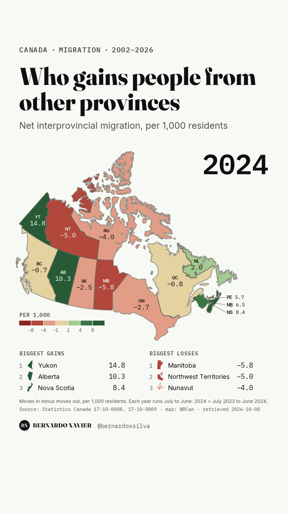
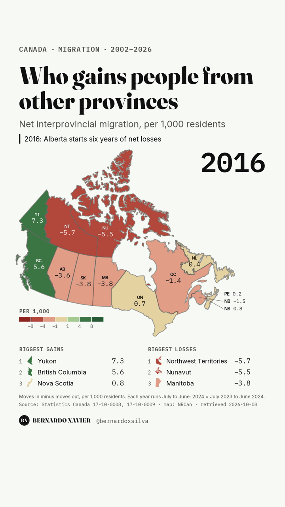
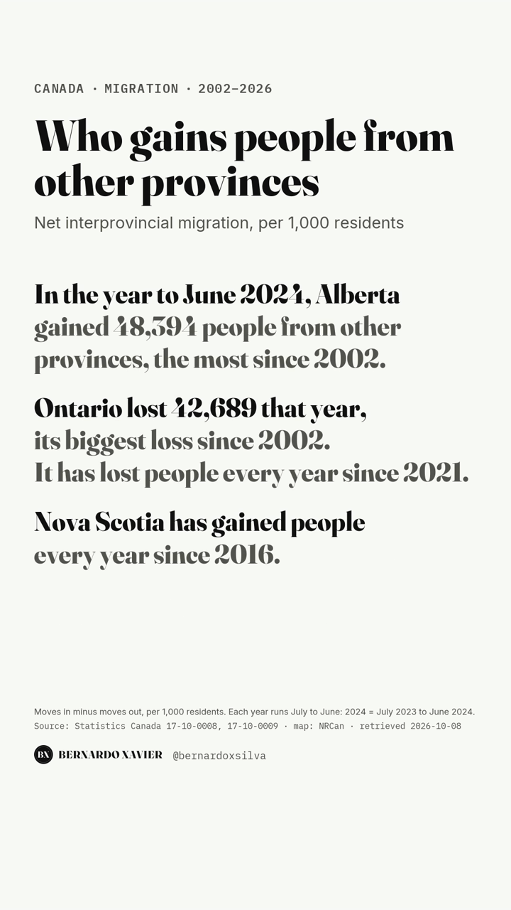

In the year to June 2024, Alberta gained 48,394 people from the rest of Canada. That was its largest net gain since 2002, the first year in the series. The same year, Ontario lost 42,689 people to other provinces, its largest loss in the series. The data comes from Statistics Canada and covers every province and territory from 2002 to 2026.

## What the data shows

Net interprovincial migration is the number of people who move into a province from elsewhere in Canada, minus the number who move out. It leaves out births, deaths and immigration from other countries. To compare provinces of different sizes, I divided it by the population at the start of each year and show the rate per 1,000 residents.

Each year runs from July to June, so "2024" means July 2023 to June 2024.

**Alberta's swing is the largest story.** From 2016 to 2021, Alberta lost people to other provinces for six years in a row, 47,781 people in total. Its worst year was 2017, with a net loss of 15,559. Then it turned. In 2024, it gained 48,394, or 10.3 per 1,000 residents.

**Ontario has lost people every year since 2021.** Its net loss peaked at 42,689 in 2024, or 2.7 per 1,000 residents. Ontario is the largest province, so a large number of people is a small rate.

**Some patterns hold for decades.** Quebec and Manitoba had a net loss in every year from 2002 to 2026. Nova Scotia has gained people every year since 2016.

**The most recent year is calmer, but the direction is the same.** In the preliminary estimate for July 2025 to June 2026, Alberta gained 21,662 people and Ontario lost 18,015.

## How I built it

The project is a small Python pipeline with three steps:

1. `coletar.py` downloads three Statistics Canada tables through the agency's Web Data Service API and keeps a local copy.
2. `compor.py` builds one tidy table: province, year, net migration, population and the rate per 1,000.
3. `render.py` passes that table to a reusable map template, which draws every frame with matplotlib and encodes the video with ffmpeg.

Two automatic checks run before any frame is drawn. If either fails, the pipeline stops.

- **The total must be zero.** Every move out of one province is a move into another, so the 13 net figures must add up to zero in every year. They do, in all 25 years.
- **A second table must agree.** Statistics Canada also publishes every move by province of origin and destination (table 17-10-0022-01). For each province and year, moves in minus moves out from that table must equal the net figure exactly. They match with no difference.

The phrases in the video are not typed by hand. The code finds Alberta's peak year and Ontario's and Nova Scotia's runs in the data. If a new release breaks one of these claims, an assertion stops the render.

## Caveats

- **2026 is preliminary.** Statistics Canada revises its estimates, so the latest year may change.
- **Small populations swing hard.** In 2024, Yukon had the highest rate of any province or territory, 14.8 per 1,000. In 2026, the Northwest Territories had the lowest, −17.4 per 1,000, from a net loss of 801 people. A rate is fair for comparing provinces, but in the territories a few hundred moves change it a lot.
- **This is only movement inside Canada.** A province can lose people to other provinces and still grow, because of immigration and births.

## What I take from it

These flows can reverse fast: Alberta went from six years of losses to the largest gain in the series in three years. I find the rate per 1,000 the fairer comparison, but I always read it next to the raw count.

## Sources

- Statistics Canada, Table 17-10-0008-01, "Estimates of the components of demographic growth, annual": https://www150.statcan.gc.ca/t1/tbl1/en/tv.action?pid=1710000801
- Statistics Canada, Table 17-10-0009-01, "Population estimates, quarterly": https://www150.statcan.gc.ca/t1/tbl1/en/tv.action?pid=1710000901
- Statistics Canada, Table 17-10-0022-01, "Estimates of interprovincial migrants by province or territory of origin and destination, annual": https://www150.statcan.gc.ca/t1/tbl1/en/tv.action?pid=1710002201
- Map: Natural Resources Canada, Atlas of Canada 1:5,000,000.

All data retrieved 2026-10-08.
