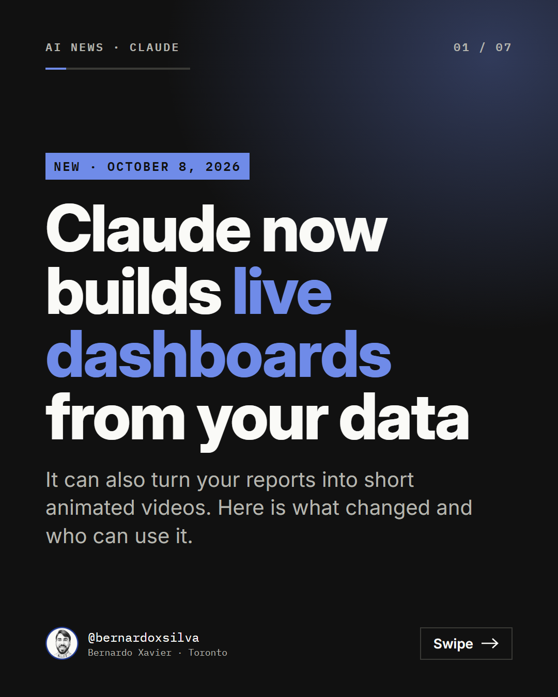
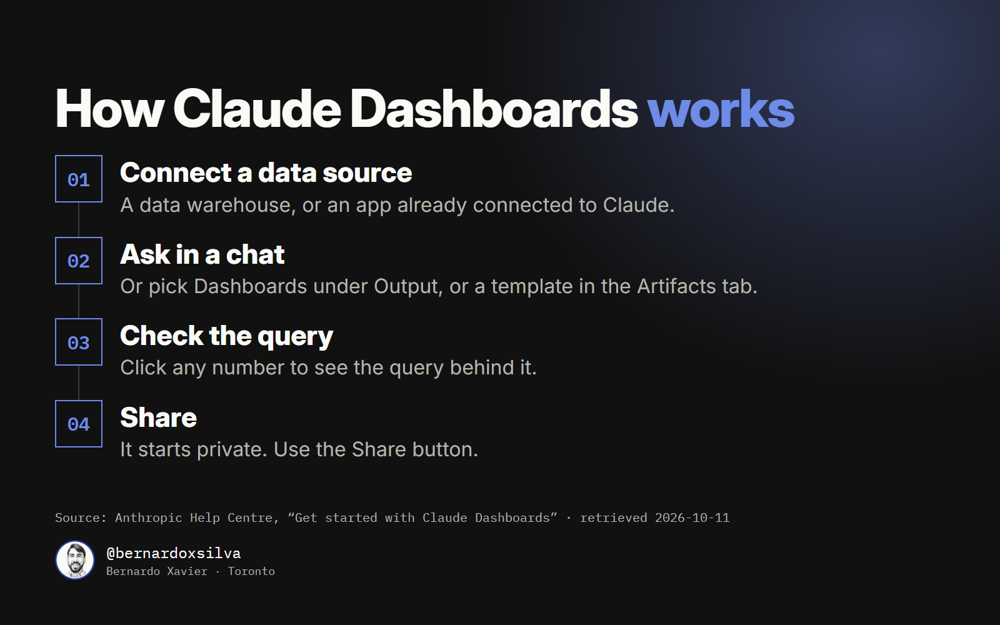
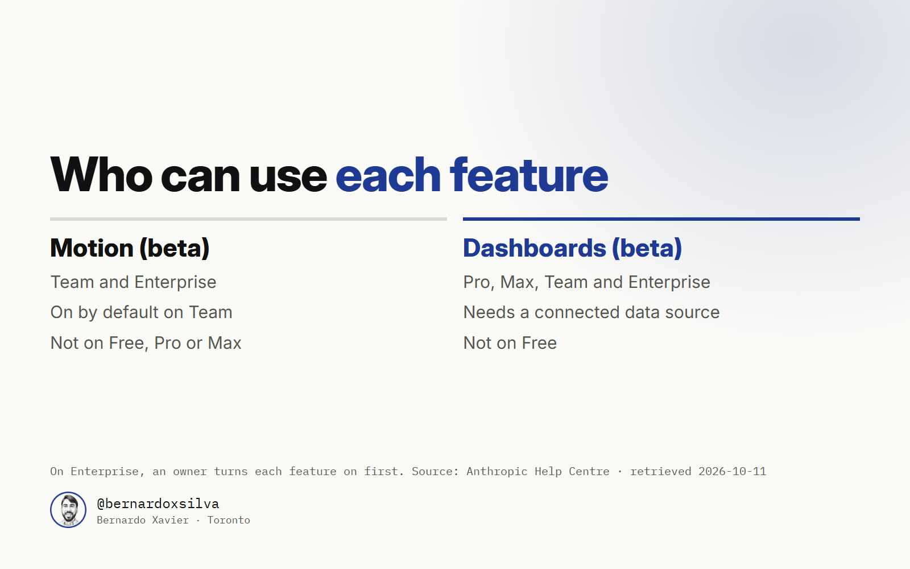

Claude Dashboards turns a plain-English question about your data into charts that stay up to date. Anthropic announced it on October 8, 2026, together with Claude Motion, which turns your reports into short animated videos. Both features are in beta. This post explains what each one does, how to try it and who can use it.

## What Dashboards does

First, you connect a data source. Anthropic lists data warehouses such as Amazon Redshift, BigQuery, ClickHouse, Databricks and Snowflake. It also lists business apps already connected to Claude, such as Salesforce.

Then you ask a question in a chat. Claude writes a SQL query for each chart and runs it against your data. SQL is the language that databases use to answer questions.

The charts stay current as the data changes. Each chart shows when its data was last refreshed. To check a number, click it to see the query behind it, or ask Claude to explain it.

## How to try it

You can start in three ways:

- Ask for a dashboard in any chat.
- Select **Output** in the message box and choose **Dashboards**.
- Open the **Artifacts** tab, pick a Dashboards template and describe what you want.

Anthropic's help centre gives these example prompts:

> "Build a dashboard of this quarter's revenue by region."
>
> "Show weekly signups for the last six months, split by plan."
>
> "Make a dashboard of my open Salesforce opportunities by stage and owner."

A dashboard starts private to you. To show it to other people, open it and click **Share**.

Anthropic says dashboards are made for quick, exploratory questions. For deeper analysis, you can send a dashboard to another tool. The launch article lists Amplitude, Grafana, Hex, Mixpanel, Omni, Perplexity, PostHog and Sigma, with Looker, monday.com and Tableau coming soon.

## What Motion does

Motion turns your own reports, data or images into an animated explainer. You export the result as an MP4 video. Anthropic says Motion does not use a video generation model, so there is no generated footage and no AI-generated people.

The help centre gives three tips. Say who will watch the video, where it will play and roughly how long it should be. Attach the files that you want Claude to use. Then ask for changes in the chat. One of its example prompts is:

> "Turn this quarterly report into a 30-second explainer for our all-hands."

You can also open an animation in Adobe, Descript, HeyGen, Higgsfield, invideo, Luma AI or Runway. Canva and Captions are coming soon.

## Who can use it

| Feature | Plans | Notes |
| --- | --- | --- |
| Dashboards (beta) | Pro, Max, Team and Enterprise | Needs a connected data source. Not on Free |
| Motion (beta) | Team and Enterprise | On by default on Team. Not on Free, Pro or Max |

On Enterprise plans, an owner must turn each feature on first, in **Organization settings > Artifacts**. Both features count toward your plan's usage limits. For Motion, longer or more complex animations use more of the limit.

On October 11, 2026, Anthropic's pricing page listed Pro at $20 a month billed monthly, or $17 a month with annual billing. The page does not name the currency.

On the same day as this launch, Anthropic said that Docs, Slides and Design are out of beta and on every plan, including Free.

## What this means for you

For most individual users, the change is smaller than the headline suggests. Dashboards needs a paid plan and a connected data source, and Motion needs a Team or Enterprise plan. If you have both, I recommend one habit: open the query before you share a number. A chart is only as good as the question behind it.

## Sources

- Anthropic, "Build live dashboards and animate explainers with Claude", claude.com, 2026-10-08: https://claude.com/resources/articles/dashboards-and-motion
- Anthropic Help Centre, "Get started with Claude Dashboards": https://support.claude.com/en/articles/17454700-get-started-with-claude-dashboards
- Anthropic Help Centre, "Get started with Claude Motion": https://support.claude.com/en/articles/17454997-get-started-with-claude-motion
- Anthropic, Claude pricing: https://claude.com/pricing

All sources retrieved 2026-10-11.
